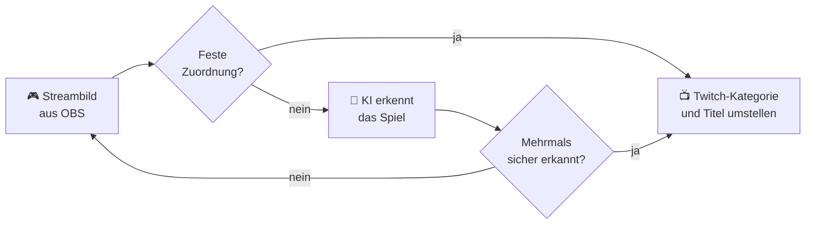

<div align="center">


# TitleSync für OBS

**Du wechselst das Spiel, dein Stream zieht automatisch mit.**

Das OBS-Plugin erkennt per KI, was gerade in deinem Stream läuft, und hält **Titel und Kategorie auf Twitch und YouTube** automatisch aktuell. Kostenlos, ohne API-Key, direkt in OBS.

*(früher „KI Game Switcher“)*

[](https://github.com/BellocccYT/titlesync/releases/latest)
[](https://github.com/BellocccYT/titlesync/releases)
[](https://obsproject.com)
[](LICENSE)

### [⬇️ Setup für Windows herunterladen](https://github.com/BellocccYT/titlesync/releases/latest) · [🌐 Webseite](https://bellocccyt.github.io/titlesync/)

</div>

---

<table align="center">
<tr>
<td align="center" width="50%">

</td>
<td width="50%">

### 😩 Ohne TitleSync

Spiel wechseln → Alt-Tab → Dashboard öffnen → Titel tippen → Kategorie suchen → Tags anpassen …

*… oder vergessen, und der Chat fragt, warum da seit zwei Stunden „Minecraft“ steht.* 💀

### 😎 Mit TitleSync

Spiel wechseln. **Fertig.**

Titel, Kategorie und Tags ziehen von selbst nach, auf Twitch und YouTube, mit **0 Klicks**.

</td>
</tr>
</table>

<div align="center">

| 🆓 **Kostenlos** | 🔒 **Lokal** | ⚡ **Automatisch** | 🎙️ **Hört zu** |
|:---:|:---:|:---:|:---:|
| Open Source, ohne Abo | KI auf deinem PC, ohne API-Key | Erkennt Spiel und Fortschritt | Schlagwörter aus deiner Stimme |

</div>

<details>
<summary>🇬🇧 <b>In English</b></summary>

**TitleSync** is a free, open-source OBS plugin: an AI looks at your stream, recognizes the game you're playing and automatically updates your **Twitch title, category and tags** plus your **YouTube live title**. It runs locally with Ollama by default – no account, no API key, no image leaves your PC.

The interface is available in **English and German** and follows your OBS language automatically (you can change it at the bottom of the settings window).

**Install (Windows):** download the [setup](https://github.com/BellocccYT/titlesync/releases/latest), keep “Install Ollama” checked, start OBS, open the **TitleSync** dock → **Settings … → Twitch → Connect with Twitch**. Requires OBS Studio 31+.

</details>

## ✨ Was es kann

| | |
|---|---|
| 🧠 **KI auf deinem PC** | Standardmäßig rechnet Ollama lokal auf deiner Grafikkarte: kostenlos, ohne Account, ohne Limits. Kein Bild verlässt deinen PC. |
| 👀 **Erkennt am echten Streambild** | Die KI sieht genau das, was deine Zuschauer sehen. Das klappt auch mit Konsole, Capture-Card oder Emulator. |
| 🛡️ **Kein nervöses Hin- und Herspringen** | Gewechselt wird erst nach mehreren sicheren Erkennungen hintereinander. Ein kurzer Alt-Tab zu Discord löst nichts aus. |
| ✍️ **Titel in deinem Stil** | Fertige Stile (Locker, Hype, Witzig, Sachlich), feste Teile wie `[DE]` oder `\| !discord`, die immer dranhängen, Deutsch oder Englisch, Emojis an oder aus. |
| 🗺️ **Titel folgt deinem Fortschritt** | Neues Level, Bosskampf, neue Welt? Der Titel zieht mit, ohne dass die Kategorie wechselt. |
| 🎙️ **Hört auf deine Stimme** | Sagst du „heute Hardcore-Run“, landet das im Titel. Die Spracherkennung läuft lokal, nichts wird aufgezeichnet. |
| 🎯 **100 % sicher mit Zuordnungen** | `javaw.exe → Minecraft` einmal festlegen, dann wird ganz ohne KI sofort umgestellt. Bei Emulatoren auch mehrere Spiele pro Programm, je mit eigenem Titel und eigenen Tags. |
| 🔎 **Doppelt geprüft** | Vor einem Wechsel vergleicht die KI das Bild mit Screenshots aus dem Steam-Shop. Verwechslungen fallen so meist auf. |
| 🖥️ **Eigenes Dock in OBS** | Live-Status, Vorschaubild, Verlauf, „Jetzt prüfen“, „Test“, Pause und „Falsch erkannt?“ |
| 🌍 **Deutsch & English** | Die Oberfläche folgt automatisch der Sprache von OBS, umstellbar unten im Einstellungsfenster. |

## ⚙️ So funktioniert's



Geprüft wird standardmäßig **nur während du live bist**, einmal pro Minute, und sofort beim Go-Live.

## 🚀 Installation (Windows)

1. **[Setup herunterladen](https://github.com/BellocccYT/titlesync/releases/latest)** (`titlesync-…-windows-x64-setup.exe`) und starten.
2. Haken bei **„Ollama installieren und Bildmodell laden“** lassen. Damit bekommst du die kostenlose KI gleich mit. Das sind ca. 4,9 GB Download, und deine Grafikkarte braucht mindestens 4 GB Speicher.
3. OBS starten. Das Dock **TitleSync** erscheint automatisch.
4. Im Dock auf **Einstellungen … → Twitch → Mit Twitch verbinden** klicken. Fertig! 🎉

> [!NOTE]
> **Windows meldet „Der Computer wurde durch Windows geschützt“?** Das Setup ist noch nicht digital signiert. Klick auf **Weitere Informationen → Trotzdem ausführen**.

> [!WARNING]
> **„Fehler beim Laden von Plugins“?** Unter Windows 11 blockiert die *Intelligente App-Steuerung* (Smart App Control) unsignierte Plugins. Im OBS-Log steht dann `LoadLibrary failed … (4551)`. Bis es eine signierte Version gibt, hilft nur, die Intelligente App-Steuerung abzuschalten (Windows-Sicherheit → App- & Browsersteuerung).

Voraussetzung ist **OBS Studio 31 oder neuer**. Deinstallieren kannst du über **Windows-Einstellungen → Apps**. Ollama und deine Einstellungen bleiben dabei erhalten.

<details>
<summary>Manuell mit der ZIP-Datei installieren</summary>

1. Unter [Releases](https://github.com/BellocccYT/titlesync/releases/latest) die Datei `titlesync-…-windows-x64.zip` herunterladen
2. OBS schließen
3. Den Inhalt der ZIP nach `C:\ProgramData\obs-studio\plugins\` entpacken. Danach existiert `C:\ProgramData\obs-studio\plugins\titlesync\bin\64bit\titlesync.dll`.
4. Ollama von [ollama.com](https://ollama.com) installieren und `ollama pull qwen3-vl:4b-instruct` ausführen
5. OBS starten → **Docks → TitleSync**

</details>

<details>
<summary>Linux und macOS (experimentell)</summary>

Diese Pakete werden automatisch gebaut, wurden aber noch nicht auf echten Geräten getestet. Rückmeldungen sind sehr willkommen!

**Linux, alle Distributionen (Fedora, Arch, openSUSE, Ubuntu …), empfohlen:** `titlesync-…-x86_64-linux-setup.AppImage` herunterladen, OBS schließen, die Datei ausführbar machen (Rechtsklick → Eigenschaften → „Als Programm ausführen“ oder `chmod +x titlesync-*-linux-setup.AppImage`) und doppelklicken. Das Setup erkennt selbst, ob OBS normal oder als **Flatpak** installiert ist, prüft die OBS-Version und legt das Plugin an die richtige Stelle, ohne root. Ein erneuter Start bietet Aktualisieren oder Entfernen an.

Ohne AppImage geht es auch im Terminal mit `titlesync-…-x86_64-linux-portable.tar.xz`:

```bash
tar -xf titlesync-*-x86_64-linux-portable.tar.xz
./install.sh            # entfernen: ./install.sh --uninstall
```

**Ubuntu, Debian, Linux Mint, Pop!_OS (OBS aus der Paketverwaltung):** alternativ `titlesync-…-x86_64-linux-gnu.deb` mit `sudo apt install ./titlesync-…-x86_64-linux-gnu.deb` installieren.

Voraussetzung ist **OBS Studio 31.1 oder neuer** und eine aktuelle Distribution (glibc 2.38 oder neuer). Für die lokale KI zusätzlich Ollama: `curl -fsSL https://ollama.com/install.sh | sh`, danach `ollama pull qwen3-vl:4b-instruct`.

**macOS:** `titlesync-…-macos-universal.pkg` herunterladen und öffnen.

</details>

## 🧪 Ausprobieren

Starte ein Spiel und klicke im Dock auf **Test**. Du siehst dann das Bild, das die KI bekommen hat, und was sie erkannt hat. Auf Twitch wird dabei nichts geändert.

## 🧠 KI-Anbieter

Einstellen kannst du das unter **Einstellungen … → KI**.

| Anbieter | Kosten | Was du brauchst |
|---|---|---|
| **Ollama** ⭐ Standard | kostenlos, lokal, ohne Key und ohne Limits | [Ollama](https://ollama.com) und `ollama pull qwen3-vl:4b-instruct` (3,3 GB). Das Setup erledigt beides für dich. Braucht ca. 4 GB Grafikspeicher. Auf einer RX 6750 XT dauert eine Prüfung ca. 6–7 s. |
| **Google Gemini** | in der EU, der Schweiz und Großbritannien laut Googles API-Bedingungen nur kostenpflichtig (Google-Cloud-Projekt mit Abrechnung) | API-Key von [aistudio.google.com/apikey](https://aistudio.google.com/apikey) |
| **OpenRouter** | kostenlose Modelle verfügbar | Key von [openrouter.ai/keys](https://openrouter.ai/keys). Ohne Guthaben nur ca. 50 Anfragen am Tag, Intervall daher mindestens 5 Minuten. |
| **Anthropic Claude** | kostenpflichtig | Key von [platform.claude.com](https://platform.claude.com) |
| **LM Studio** / **Jan** / **llama.cpp** | kostenlos, lokal, ohne Key | Programm installieren, ein Bildmodell laden (z. B. Qwen3-VL) und den lokalen Server starten. Dann „Modelle laden“. |
| **NVIDIA NIM** | kostenloser Key, ca. 40 Anfragen/Minute | Key von [build.nvidia.com](https://build.nvidia.com) (Registrierung). Modell Nemotron 3 Nano Omni: erkennt zuverlässig in 2–3 s, bei Andrang kurz ausgelastet. |
| **Cloudflare Workers AI** | kostenloses Tageskontingent | API-Token mit „Workers AI“-Recht von [dash.cloudflare.com](https://dash.cloudflare.com/profile/api-tokens), in der Server-URL `ACCOUNT_ID` durch deine Account-ID ersetzen |
| **Groq** | kostenloser Key mit Tageslimit, sehr schnell | Key von [console.groq.com/keys](https://console.groq.com/keys). Die Llama-Bildmodelle wurden im Juli 2026 eingestellt, nur noch Qwen-Modelle als Vorschau. |
| **Mistral** | Gratis-Stufe stark eingeschränkt, sonst kostenpflichtig | EU-Anbieter. Key von [console.mistral.ai](https://console.mistral.ai/api-keys) |
| **Eigener Server** | – | Jede OpenAI-kompatible Schnittstelle |

Bei Online-Anbietern prüfst du den Key mit **Modelle laden** und wählst dabei gleich ein Modell aus. Ist das Hauptmodell überlastet oder hat es sein Limit erreicht, springt automatisch das **Ersatzmodell** ein.

## 🎯 Genauer erkennen

- **Feste Zuordnungen:** Im Reiter **Zuordnungen** legst du fest, welches Programm zu welcher Twitch-Kategorie gehört. „Aktuelle Aufnahmen übernehmen“ trägt die gerade aufgenommenen Programme automatisch ein.
- **Emulatoren:** Ein Programm, viele Spiele. Trag den Emulator mehrmals ein, jeweils mit einem Teil des Fenstertitels, z. B. `Dolphin.exe` + „Mario Kart“ → *Mario Kart: Double Dash!!* und `Dolphin.exe` + „Sunshine“ → *Super Mario Sunshine*. Bei Dolphin, Citron, Ryujinx, RetroArch, PCSX2 und Co. schlägt das Plugin den Spielnamen aus dem Fenstertitel schon vor.
- **Steam-Abgleich:** Bevor die KI das Spiel wechselt, holt das Plugin zwei Screenshots des vermuteten Spiels aus dem Steam-Shop und lässt die KI vergleichen. Passt es nicht, prüft es die Alternativen der KI. Passt keine, bleibt alles, wie es ist. Das dauert pro Wechsel ein paar Sekunden länger, abschaltbar unter **Erkennung**. Spiele, die es nicht bei Steam gibt, werden ohne Abgleich umgestellt.
- **Gesperrte Kategorien:** Unter **Erkennung → Nie umstellen auf** stehen Kategorien, auf die die KI nie wechseln darf, z. B. ein Spiel, mit dem sie deins gern verwechselt.
- **Falsch erkannt?** Im Dock setzt du die richtige Kategorie sofort. Auf Wunsch merkt sich das Plugin die Zuordnung. Ohne „Merken“ stellt die KI danach 15 Minuten lang nicht um.
- **Programm-Hinweise:** Die KI erfährt, welche Programme OBS aufnimmt, samt Fenstertitel. Bei Emulatoren wie Dolphin steht dort meist das laufende Spiel.
- **Nur die Spielaufnahme zeigen:** Unter **Erkennung → Bildquelle** deine Spielaufnahme wählen. Dann lenken Webcam, Overlays und Browserfenster nicht ab.

<details>
<summary>📋 Alle Einstellungen</summary>

| Reiter | Einstellung | Bedeutung |
|---|---|---|
| Erkennung | Prüfintervall | Abstand zwischen zwei Prüfungen (Standard 60 s) |
| | Bildquelle | Programmausgabe oder eine einzelne Quelle |
| | Mindest-Sicherheit | Unsichere Erkennungen werden ignoriert |
| | Nur während du live bist | Live heißt: OBS streamt oder Twitch meldet deinen Kanal als live (jede Minute abgefragt) |
| | Bestätigungen | So oft hintereinander muss ein neues Spiel erkannt werden (Standard 2) |
| | Ohne Spiel | z. B. `Just Chatting`, wenn kein Spiel zu sehen ist. Leer lassen, dann bleibt die Kategorie. |
| | Aktives Fenster mitsenden | Fenstertitel und Prozessname als Hinweis an die KI |
| | Steam-Abgleich | Vor dem Umstellen mit Steam-Screenshots vergleichen (Standard an) |
| | Nie umstellen auf | Kategorien, auf die die KI nie wechselt |
| Twitch | Tags bei jedem Wechsel | z. B. `Deutsch, Gaming`. Leer = deine Tags bleiben unangetastet. |
| Titel | Titel | KI schreibt ihn, eine Vorlage wird verwendet oder der Titel bleibt unverändert |
| | Stil | Locker, Hype, Witzig, Sachlich oder nur eigene Ergänzungen. Keine langen Anweisungen nötig. |
| | Sprache / Emojis | Deutsch oder Englisch. Mit „Emojis aus“ entfernt das Plugin Emojis selbst, egal was das Modell schreibt. |
| | Vorlage | Platzhalter `{game}`, `{scene}` (Situation im Spiel) und `{keywords}` (Stichwörter aus deiner Stimme) |
| | Immer vorne / hinten | Feste Teile wie `[DE]` oder `\| !discord`. Das Plugin setzt sie selbst an jeden Titel. |
| | Spielfortschritt | Titel auch bei neuem Abschnitt im selben Spiel anpassen. **Wie oft:** Selten (Bosskampf, Sieg, Niederlage), Normal (jeder Wechsel der Aktivität außer gewöhnlichen Kämpfen) oder Häufig (jeder Wechsel, sofort). Frühestens alle 15 Minuten, einstellbar ab 2 Minuten. |
| YouTube | Client-ID / Clientschlüssel | Eigenes Google-Cloud-Projekt, Schritt-für-Schritt-Anleitung im Reiter |
| Stimme | Stimme mithören | Lokale Spracherkennung (whisper.cpp), Mikrofon und Modell wählbar. Standard aus. |
| Zuordnungen | | Programm, Fenstertitel enthält (für Emulatoren), Kategorie, eigener Titel, Tags |

**Sprache der Oberfläche:** Ganz unten im Einstellungsfenster: Automatisch (wie OBS), Deutsch oder English. Das Dock wechselt nach einem Neustart von OBS.

**Tastenkürzel:** Unter **OBS-Einstellungen → Tastenkürzel** findest du „TitleSync: Jetzt prüfen“, „Test“ und „Pausieren / Fortsetzen“.

</details>

## ▶️ YouTube

Das Plugin setzt auch den **Titel deines YouTube-Livestreams**, zusätzlich zu Twitch oder allein. Eine Spiel-Kategorie wie bei Twitch kennt die YouTube-Schnittstelle nicht.

Dafür brauchst du einmalig ein eigenes, kostenloses Google-Cloud-Projekt. Die Anleitung steht im Reiter **Einstellungen → YouTube**:
1. Projekt anlegen und die YouTube Data API v3 aktivieren
2. OAuth-Zustimmungsbildschirm einrichten (Extern, dich selbst als Testnutzer eintragen)
3. Client vom Typ „Fernseher und Geräte mit begrenzter Eingabe“ erstellen
4. Client-ID und Clientschlüssel eintragen und auf **Mit YouTube verbinden** klicken

Google zeigt dabei „App nicht überprüft“. Das ist bei eigenen Projekten normal. Das Tageslimit deines Projekts reicht für rund 150 Titeländerungen.

## 🔒 Datenschutz

- **Mit Ollama (Standard) verlässt kein Bild deinen PC.**
- Bei Online-Anbietern geht pro Prüfung ein verkleinertes Standbild deines Streams an den Anbieter. Das ist genau das, was deine Zuschauer ohnehin sehen. Ist „Aktives Fenster mitsenden“ an, kommen Fenstertitel und Prozessname dazu. Fenstertitel können private Infos enthalten, z. B. Browser-Tabs. Es gelten die Datenschutzbedingungen des Anbieters.
- **Stimme:** Die Spracherkennung läuft lokal auf dem Prozessor. Es wird nichts aufgezeichnet oder gespeichert. Im Arbeitsspeicher liegen nur die letzten zwei Minuten Audio und der erkannte Text der letzten drei Minuten. Der Text geht nur dann an die gewählte KI, wenn ein neuer Titel geschrieben wird, bei Ollama also nirgendwohin. Das Sprachmodell wird beim Einschalten einmalig von huggingface.co geladen.
- **Steam-Abgleich:** Das Plugin fragt beim Steam-Shop nach dem vermuteten Spielnamen und lädt zwei öffentliche Screenshots. Dein Streambild geht dabei nicht an Steam.
- Twitch erlaubt dem Plugin nur, Titel, Kategorie und Tags deines Kanals zu ändern (`channel:manage:broadcast`).
- API-Keys und der Twitch-Login liegen nur lokal in `%APPDATA%\obs-studio\plugin_config\titlesync\`. **Trennen** löscht den Twitch-Login.

## 🛠️ Fehlerbehebung

Meldungen erscheinen im Dock und im Verlauf, Details stehen im OBS-Log (**Hilfe → Protokolldateien**).

| Meldung | Lösung |
|---|---|
| `Ollama nicht erreichbar` | Läuft Ollama (Symbol im Infobereich der Taskleiste)? Ist das Modell geladen? |
| `Kein Bild` | Läuft das Spiel? Zeigt OBS die Spielaufnahme an? |
| `API-Key ungültig` | Key in den Einstellungen prüfen, dann „Modelle laden“ |
| `Modell nicht gefunden` | „Modelle laden“ und ein Modell aus der Liste wählen |
| `… ist gerade überlastet` / `antwortet nicht` | Der Anbieter ist ausgelastet. Das Ersatzmodell springt ein, sonst klappt es meist bei der nächsten Prüfung. |
| `Limit für … erreicht` | Kontingent aufgebraucht. Intervall erhöhen oder später wieder versuchen. |
| `Twitch-Anmeldung abgelaufen` | Nach 30 Tagen ohne Nutzung neu verbinden |

Ein Fehler oder eine Idee? Schreib ein [Issue](https://github.com/BellocccYT/titlesync/issues)!

## 🧑‍💻 Selbst bauen

<details>
<summary>Anleitung für Entwickler</summary>

Voraussetzungen unter Windows: Visual Studio 2022 (oder Build Tools) mit C++-Workload und Windows SDK 10.0.22621, CMake ≥ 3.28.

```bash
cmake --preset windows-x64
```

```bash
cmake --build --preset windows-x64 --config RelWithDebInfo
```

Die DLL landet in `build_x64/RelWithDebInfo/`. Den Installer baust du mit [Inno Setup 6](https://jrsoftware.org/isinfo.php), nachdem du das Plugin mit `cmake --install build_x64 --config RelWithDebInfo --prefix release/RelWithDebInfo` bereitgelegt hast:

```bash
ISCC.exe /DAppVersion=1.5.0 installer/titlesync.iss
```

Für macOS und Linux gibt es die Presets `macos` und `ubuntu-x86_64`. Die GitHub-Actions-Workflows bauen alle drei Plattformen samt Windows-Setup automatisch und hängen bei Tags die Pakete an ein Release.

Das Projekt basiert auf der offiziellen [obs-plugintemplate](https://github.com/obsproject/obs-plugintemplate).

</details>

## ✍️ Code-Signing-Richtlinie

Die Windows-Dateien sind **noch nicht signiert**. Sobald das Projekt bekannter ist, folgt ein Antrag auf kostenlose Signierung über [SignPath.io](https://signpath.io) mit einem Zertifikat der [SignPath Foundation](https://signpath.org). Signiert werden dann ausschließlich Dateien, die GitHub Actions direkt aus dem Quellcode dieses Repositorys baut. Bis dahin kannst du jeden Download mit den SHA-256-Prüfsummen auf der Release-Seite prüfen.

| Rolle | Wer |
|---|---|
| Autor und Prüfer (Committer, Reviewer) | [Belloccc](https://github.com/BellocccYT) |
| Freigabe von Signaturen (Approver) | [Belloccc](https://github.com/BellocccYT) |

**Datenschutz:** Dieses Programm überträgt keine Daten an andere vernetzte Systeme, außer wenn der Nutzer das ausdrücklich einrichtet: an den gewählten KI-Anbieter (bei Ollama nur lokal auf dem eigenen PC) und an Twitch, um Titel und Kategorie zu ändern. Details stehen unter [Datenschutz](#-datenschutz).

<details>
<summary>English</summary>

Windows binaries are **not signed yet**. Once the project is more widely known, we will apply for free code signing via [SignPath.io](https://signpath.io) with a certificate issued by the [SignPath Foundation](https://signpath.org). Only artifacts built by GitHub Actions directly from this repository's source code will be signed. Until then, every download can be verified with the SHA-256 checksums on the release page. Committers, reviewers and approvers: [Belloccc](https://github.com/BellocccYT).

Privacy policy: This program will not transfer any information to other networked systems unless specifically requested by the user or the person installing or operating it: the AI provider chosen by the user (Ollama runs locally) and Twitch, to update the channel's title and category.

</details>

## ⭐ Gefällt dir TitleSync?

Lass gern einen **Stern** oben rechts da. Das hilft anderen Streamern, das Plugin zu finden. Ideen, Fehler oder Fragen? Ab damit in die [Issues](https://github.com/BellocccYT/titlesync/issues). Jede Rückmeldung macht TitleSync besser. 💜

## 📄 Lizenz

GPL-2.0-or-later, siehe [LICENSE](LICENSE). Nicht offiziell mit OBS Project, Twitch, Ollama oder den KI-Anbietern verbunden.

<div align="center">

Gemacht mit 💜 von **Belloccc**

</div>
